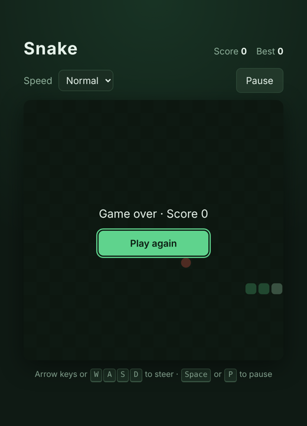
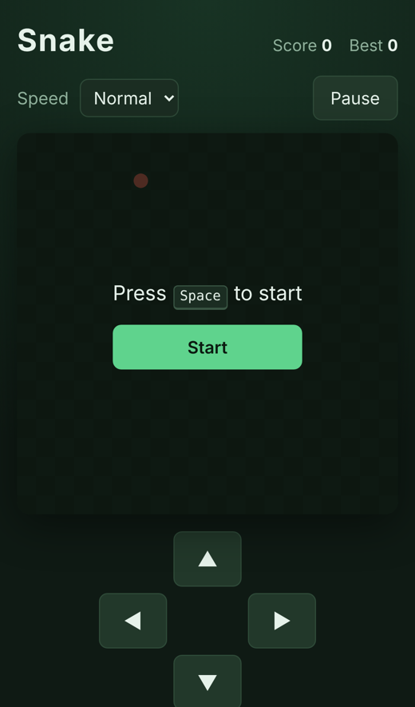

# Snake

**▶ [Play it](https://theoyanvno.github.io/snake-game/)**

The classic Snake game in the browser: eat the food, grow longer, and don't run into the walls or yourself. Works with a keyboard on a computer and with swipes or on-screen buttons on a phone.

**Tech:** vanilla JavaScript (ES modules) · HTML5 Canvas · CSS · `localStorage` · `node:test` · no frameworks or build step

| Desktop | Phone |
|---|---|
|  |  |

## Features

- **Controls:** arrow keys or WASD; on a phone, swipe on the board or use the direction pad
- **Speed levels:** slow, normal and fast, and the snake speeds up a little every 5 points
- **No-walls mode:** turn off Walls and the snake wraps around to the other side (the board gets a dashed edge)
- **Best score** for each speed level and mode, saved in the browser
- **Pause** with Space, P or the Pause button; the game also pauses itself when you switch tabs
- Quick turns are queued, so pressing two directions fast makes a tight U-turn instead of losing a key press
- Sharp on high-resolution screens (the canvas is drawn at the device's pixel density)

## How it works

| File | What it does |
|---|---|
| [`src/game.js`](src/game.js) | The rules, with no browser code: moving, turning, eating, growing, collisions, wrapping, food placement and speed |
| [`src/app.js`](src/app.js) | Drawing on the canvas, the game loop, keyboard and touch input, pause and best scores |
| [`test/game.test.js`](test/game.test.js) | 13 tests for the rules |

Keeping the rules separate from the drawing makes them easy to test. A few details the tests cover:

- A turn straight back into the body is ignored, checked against the last *queued* turn, not just the current direction
- The snake may move into the cell its tail is leaving on the same step
- Food is only placed on empty cells, and filling the whole board is a win
- With walls off, the head wraps with modulo arithmetic (`(x + width) % width`), but hitting your own body still ends the game

The game loop uses `setTimeout` with a delay from `tickMs(level, score)`, so the speed can change as the score goes up.

## Run it

No install needed. Serve the folder (ES modules don't load from `file://`):

```bash
npm start      # python3 -m http.server 8000, then open http://localhost:8000
npm test       # 13 tests (Node 18+)
```

Built with help from AI coding tools for planning, code review and tests.
